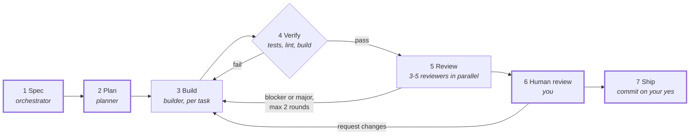

# Slipyard

**A Claude Code plugin that builds one feature at a time the way a careful team would: spec, plan, build, verify, review, then your sign-off before anything is committed.**


A slipway is where a ship is built and launched. Slipyard does the same for a feature. You describe it once. Slipyard writes a spec with you, a planner agent breaks it into small tasks, a builder agent does them one at a time test-first, the project's own checks must pass, and reviewer agents look at the result in parallel. You see the whole picture before anything is committed.

```
/slipyard:build add a --json flag to the stats command
```

## Why

An agent asked to "just build it" usually starts typing before anyone has agreed what done means. It reviews its own work in the same context that wrote it, and it can finish with green tests that don't cover the change. Slipyard adds structure around Claude so that doesn't happen:

- **Agreed before built.** Every run starts with a short spec: assumptions spelled out, out of scope written down, done-when as checks you can test.
- **Small steps, clean context.** Each task goes to a fresh builder agent that writes the failing test first.
- **Independent review.** Reviewers that didn't write the code read it from one angle each, with read-only tools, and their findings go back to the builder automatically.
- **You stay in charge.** It stops for you at four points you control, commits only when you say yes, and never pushes.

## How it works



Thick borders are the stops where Slipyard waits for you. Each one is a single question with clickable answers, and each can be turned off.

| # | Stage | Who | What happens |
|---|---|---|---|
| 1 | **Spec** | orchestrator | Reads the code, splits off anything that is really a second feature, and lists its assumptions. It asks only what the code can't answer, then writes what and why, out of scope, done-when and the verify commands. You approve it and pick the add-on reviewers. |
| 2 | **Plan** | `planner` | Breaks the spec into small slices that each work end to end, riskiest first, each with its test and a done-when check. Small features skip the planner. You approve the task list. |
| 3 | **Build** | `builder` | One task at a time, each in a fresh context: failing test first, then the code, then the focused tests. It stays in scope and lists anything else it notices instead of fixing it. |
| 4 | **Verify** | orchestrator | Runs the project's own tests, lint, type check and build. A failure goes back to the builder, up to 3 times. |
| 5 | **Review** | `reviewer` × 3-5 | Correctness, security and tests always; UI and performance as add-ons. Findings are checked against the code, blockers and majors go back to the builder, and only the reviewers that found them run again. |
| 6 | **Human review** | you | The done-when checklist with evidence, the diff, verify results, open findings, leftovers like debug output or missing docs, and time and tokens per stage. Approve, request changes or stop. |
| 7 | **Ship** | orchestrator | A summary and a commit message in your project's style. It commits only the files this run changed, only on your yes, and never pushes. |

## Quick start

Requires [Claude Code](https://code.claude.com) 2.1.292 or later, and a git repository with at least one commit.

```
/plugin marketplace add arttuaarnio/slipyard
/plugin install slipyard@slipyard
```

Then, in any project:

```
/slipyard:build add a stats screen showing accuracy per key
```

There is no init step. The first run creates `.slipyard/config.json` with the defaults and offers to save the verify commands it detects.

## Commands

| Command | What it does |
|---|---|
| `/slipyard:build [--model m] [--effort e] <feature>` | Runs the whole pipeline for one feature. `--model` and `--effort` override the config for every agent in this run. |
| `/slipyard:review [--model m] [--effort e] [base-ref]` | Runs only the review stage on changes you made yourself: uncommitted changes, or everything since `base-ref`. Reports findings and changes nothing. |
| `/slipyard:resume [run-id]` | Continues the latest unfinished run, or the one you name, from where it stopped. |

## Configuration

`.slipyard/config.json`, created on the first run:

```json
{
  "gates": { "spec": true, "plan": true, "humanReview": true, "ship": true },
  "maxReviewRounds": 2,
  "addonReviewers": [],
  "agents": {
    "planner": { "model": "opus", "effort": "high" },
    "builder": { "model": "sonnet", "effort": "medium" },
    "reviewer": { "model": "sonnet", "effort": "high" }
  },
  "skills": { "spec": [], "plan": [], "build": [], "review": [], "ship": [] },
  "verify": []
}
```

| Key | Meaning |
|---|---|
| `gates` | Which stages stop for you. Set one to `false` to run it without asking; all four `false` runs the pipeline start to finish unattended. |
| `maxReviewRounds` | How many review-and-fix rounds run before leftover findings go to you. |
| `addonReviewers` | Add-on reviewers to recommend at the spec stop: `"ui"`, `"performance"`. You still choose each run. With the spec gate off, these run without asking. |
| `agents` | Model (`opus`, `sonnet`, `haiku`, or a full model ID) and effort (`low` to `max`) for each agent. |
| `skills` | Skills to load at each stage. See below. |
| `verify` | Commands that must pass, such as `["npm run lint", "npm test", "npm run build"]`. Left empty, Slipyard detects them from CI and build files. |

Missing keys fall back to the defaults, so a config only needs what you change. Commit it to share settings with your team; run notes stay gitignored.

### Skills

Any skill you have installed can be added to a stage. Whoever runs that stage loads it first and follows it alongside Slipyard's own instructions:

| Stage | Loaded by |
|---|---|
| `spec`, `ship` | the orchestrator |
| `plan` | the planner |
| `build` | the builder, including when it fixes verify failures, review findings and your feedback |
| `review` | every reviewer |

Use the name as it appears in Claude Code: `plugin:skill` for plugin skills, or the plain name for your own.

```json
"skills": {
  "spec": ["agent-skills:interview-me"],
  "build": ["agent-skills:test-driven-development", "frontend-design:frontend-design"],
  "review": ["agent-skills:security-and-hardening"]
}
```

A skill only adds to Slipyard's rules and can't override them: reviewers stay read-only, and nothing is committed outside Ship. Slipyard tells you at the start of a run if a configured skill isn't installed and runs without it.

## The run folder

Each run keeps its notes in `.slipyard/runs/<date>-<feature>/`:

| File | Contents |
|---|---|
| `spec.md`, `plan.md` | The approved spec and the task list with progress ticks |
| `verify.md` | The last verify result |
| `diff-<n>.patch`, `review-<n>.md` | What each review round saw and found |
| `noticed.md`, `feedback-<n>.md` | Out-of-scope issues the builders spotted, and your change requests |
| `summary.md` | What was built, findings left open, time and tokens |
| `state.json` | Stage, status, tasks, reviewers, timestamps and token use, so `/slipyard:resume` can continue |

The folder is gitignored by default, so nothing leaks into your repository unless you commit it on purpose.

## Example run

A real run in an empty repository, from a deliberately vague request:

```
/slipyard:build build me a react landing page of some sort
```

- **Spec (3 min):** the vague request became a landing page for Slipyard itself, with all copy taken from this README and nothing invented. The spec had 6 sections, 10 done-when checks and verify commands for lint, tests and build. The UI reviewer was added as an add-on.
- **Plan (3 min):** the planner produced 6 tasks, from scaffolding Vite, React and TypeScript with tests to a final layout check at phone and desktop widths. It flagged a trap: the scaffolder offers to delete existing files, which would have wiped `.slipyard/`.
- **Build and verify (14 min):** 6 builder runs, then lint, 11 tests and the production build all passed on the first try.
- **Review round 1:** 4 reviewers found 3 major problems. Copy buttons lost their focus ring to a `clip-path`, the focus ring was invisible on one coloured band, and install commands were cut off at phone width. The builder fixed all three.
- **Review round 2:** only the correctness and UI reviewers ran again, and they confirmed the fixes.
- **Human review:** the user asked for a calmer redesign. The builder reworked it and a full review round found nothing major.
- **Total:** about 640k tokens over 30 minutes, 22 of which were human review.

## Design decisions

- **A plugin, not an app.** Slipyard is Markdown: three skills and three agents. Claude Code supplies the agent runtime, tools, permissions and UI, so there is nothing to install, build or keep running.
- **Fresh context per task.** Each builder call starts clean with only the spec, the plan and its task. The orchestrator passes file paths, not contents, so long runs stay focused and cheaper.
- **The author doesn't grade its own work.** Reviewers are separate agents with read-only tools, one focus each. The orchestrator checks every blocker and major finding against the code before acting on it, so a wrong finding doesn't turn into a wrong fix.
- **Verification uses the project's own tools.** "Done" means the project's real tests, lint and build pass, not that an agent says it works.
- **Bounded loops.** Verify fixes stop after 3 attempts and review after `maxReviewRounds`. When that isn't enough, you decide what happens next.
- **Everything on disk.** Spec, plan, reviews and state live in plain files you can read, diff, resume from, or feed into other tools.
- **Your project, your conventions.** Slipyard detects how a project tests and builds, writes commits in its existing style, and follows its CLAUDE.md. It doesn't ship its own coding style; see Ponytail below.

## Recommended: Ponytail

Slipyard decides *what* gets built and checks it; it doesn't tell the agents how lean the code should be. For that, install [Ponytail](https://github.com/DietrichGebert/ponytail), which pushes Claude toward the smallest change that fully works: no unrequested abstractions, no new dependencies for a few lines, standard library first.

```
/plugin marketplace add DietrichGebert/ponytail
/plugin install ponytail@ponytail
```

Ponytail injects its rules into subagents too, so Slipyard's planner, builder and reviewers all follow it with no extra setup. Slipyard works fine without it.

## Credits

The engineering practices in the agents (surfacing assumptions, vertical slices, test-first, reviewing tests first) draw on Addy Osmani's [agent-skills](https://github.com/addyosmani/agent-skills). Slipyard has its own skills and agents and doesn't depend on it.

## License

[MIT](LICENSE) © Arttu Aarnio
