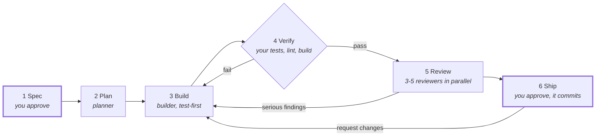

# Slipyard

**Install it, type one command, and get a planned, tested and reviewed feature, ready for you to commit.**


Slipyard is a Claude Code plugin that runs each feature through a small team of agents: a spec you approve, a plan, test-first building, your project's own checks, and independent reviewers. You approve the result before anything is committed. I built it for my own daily work, to get careful, reviewed changes without steering every step.

## Start

```
/plugin marketplace add arttuaarnio/slipyard
/plugin install slipyard@slipyard
```

Then, in any git repository:

```
/slipyard:build add a --json flag to the stats command
```

That's it. No setup, no config file. A typical run stops for you twice: to approve the spec, and to approve the result and its commit.

## What happens



1. **Spec:** turns your request into what, why, out of scope and testable done-when checks. It asks only what the request and the code don't answer.
2. **Plan:** splits the work into a few small tasks, riskiest first.
3. **Build:** a fresh builder per task writes the failing test first, then the code.
4. **Verify:** your project's real tests, lint and build must pass.
5. **Review:** correctness, security and tests reviewers (plus UI and performance when they fit) read the change in parallel. Serious findings go back to the builder.
6. **Ship:** you see the checklist, diff, findings and proposed commit, then approve, ask for changes or stop. It never pushes.

## Results

Same tasks, same model (Sonnet), plain Claude Code against Slipyard, scored on hidden acceptance tests that neither run sees. See [evals](evals/) for the method and how to rerun it.

| Suite | Arm | Hidden tests passed | Regressions | Time | Cost |
|---|---|---|---|---|---|
| Basic: 5 precise requests | Plain Claude Code | 27/27 | 0 | 1 min | $0.65 |
| | Slipyard (`--auto`) | 27/27 | 0 | 8 min | $3.10 |
| Hard: 5 vague requests with hidden edge cases | Plain Claude Code | 27/27 | 0 | 2 min | $0.71 |
| | Slipyard (`--auto`) | 27/27 | 0 | 11 min | $4.11 |

The hard suite checks what a careful engineer handles unasked: crash-safe saving, path traversal and CSV injection, old data files still loading, exact money maths. Plain Claude Code (Sonnet) got all of it right, and so did Slipyard, at about 6× the cost and time. So Slipyard does not make features more correct on small tasks like these. What it adds is process: an agreed spec before any code, independent reviews, more tests (about twice the lines changed), a record of every decision, and your approval before the commit. Whether that is worth the cost is your call; for small, clear changes it usually isn't.

## Make it yours

Slipyard needs no setup, but every agent can load any skill you have installed, so it builds the way you work:

```
/slipyard:skills builder add frontend-design:frontend-design
/slipyard:skills reviewer:security add agent-skills:security-and-hardening
/slipyard:skills
```

The last one shows what each agent loads and suggests installed skills that fit. Add `--global` to set a skill for every project. Models, effort, stops and verify commands are configurable too; see [configuration](docs/configuration.md).

## Commands

| Command | What it does |
|---|---|
| `/slipyard:build [--auto] <feature>` | Builds one feature. `--auto` skips every stop, commit approval included, for small, low-risk changes. |
| `/slipyard:review [base-ref]` | Reviews changes you made yourself. Changes nothing. |
| `/slipyard:resume [run-id]` | Continues a run that was stopped or interrupted. |
| `/slipyard:skills` | Shows and changes the skills each agent loads. |

**Tip:** the more your request says (behaviour, inputs and outputs, edge cases), the fewer questions you get. For UI work, describe the look too, or Slipyard asks about layout, style and states first.

## Learn more

- [How it works](docs/how-it-works.md): every stage, the run folder, design decisions and a real run
- [Configuration](docs/configuration.md): skills, models, stops, and fewer permission prompts
- [Evals](evals/): how Slipyard is measured against plain Claude Code

Requires Claude Code 2.1.292 or later, on macOS, Linux or Windows with WSL or Git Bash.

## Recommended: Ponytail

Slipyard decides *what* gets built and checks it, but leaves code style to you. [Ponytail](https://github.com/DietrichGebert/ponytail) pairs well with it: it pushes Claude toward the smallest change that fully works, and it applies to Slipyard's agents automatically.

## Credits

The engineering practices in the agents draw on Addy Osmani's [agent-skills](https://github.com/addyosmani/agent-skills). Slipyard doesn't depend on it.

[MIT](LICENSE) © Arttu Aarnio
